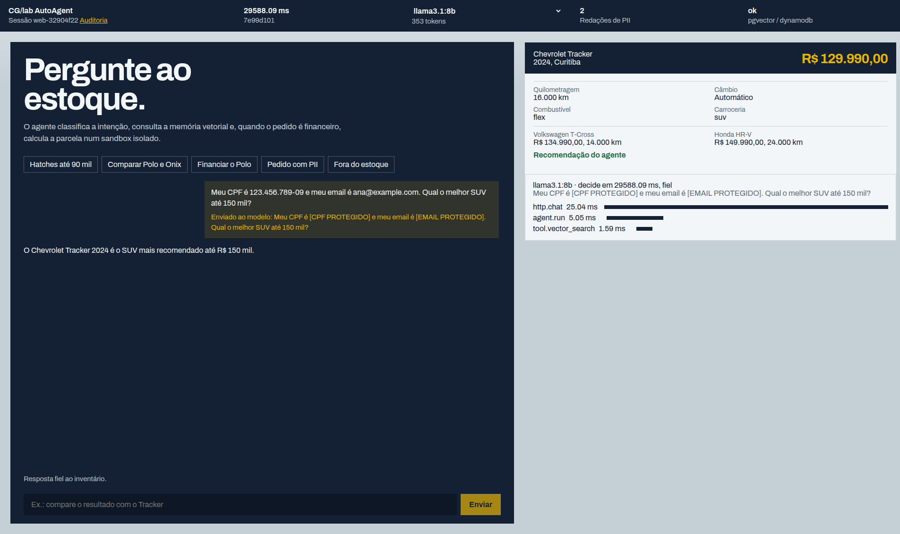
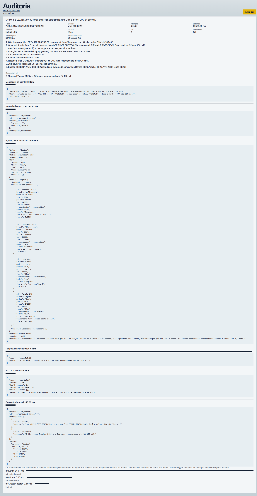

# CG/lab AutoAgent

PoC local de busca conversacional de veículos. O estoque é fictício.

## Subir

```bash
docker compose up --build
```

Abra [http://127.0.0.1:3000](http://127.0.0.1:3000).

Sobe o Postgres (porta **5434**), o DynamoDB local (**8000**), o Ollama com `llama3.1:8b`, a API (**8080**) e o frontend. A primeira subida baixa cerca de 5 GB do modelo.

`docker compose down` apaga sessões e estoque. O modelo permanece no volume. `docker compose down -v` apaga o modelo também.

## Onde cada requisito da vaga aparece

| Requisito | Onde |
| --- | --- |
| Python, asyncio e uv | `backend/pyproject.toml`, `backend/app/` |
| FastAPI, Uvicorn e SSE | `backend/app/main.py` |
| pytest, pytest-asyncio e GitHub Actions | `backend/tests/`, `.github/workflows/ci.yml` |
| Orquestração de agente (ADK; aqui, LangGraph): explorar, comparar, financiar e decidir | `backend/app/agent.py` |
| Sessão e estado do agente | `backend/app/session_store.py` |
| Memória longa, RAG, embeddings e busca vetorial (OpenSearch; aqui, pgvector) | `backend/app/text.py`, `backend/app/vector_store.py`, `backend/app/search.py` |
| LLM em streaming e cache de tokens | `backend/app/llm.py`, `backend/app/agent.py`, `docker-compose.yml` |
| DynamoDB single-table | `backend/app/session_store.py` |
| Sandbox isolado (Bedrock AgentCore; aqui, avaliador restrito) | `backend/app/sandbox.py` |
| Guardrails, redação de PII, fidelidade e taxa de alucinação | `backend/app/guardrails.py` |
| Observabilidade, trace e latência (Datadog; aqui, OpenTelemetry) | `backend/app/observability.py`, `frontend/app/audit/page.tsx` |
| OpenFeature | `backend/app/flags.py` |
| Next.js, TypeScript e UI gerada pelo agente | `frontend/app/page.tsx` |
| Terraform: DynamoDB, ECS Fargate, S3, Cognito e canary | `infra/main.tf` |

## Exemplo

Consulta no chat, com a mensagem enviada e a ficha do veículo:



Auditoria completa dessa consulta:


